<a href="https://kulturabezbarier.org/">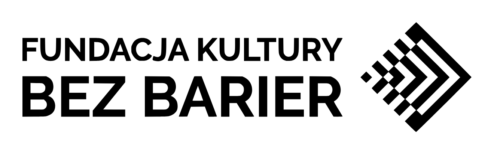</a>

# Piktogramy dostępności

Zestaw 22 piktogramów w formacie SVG (48×48, jednokolorowe) oznaczających udogodnienia dostępnościowe: audiodeskrypcję, napisy, pętlę indukcyjną, tłumaczenie na PJM, miejsca wyciszenia i inne.

**Autor piktogramów:** Tomasz Grabowski  
**Prawa autorskie:** [Fundacja Kultury Bez Barier](https://kulturabezbarier.org/)  
**Licencja:** [CC BY-SA 4.0](https://creativecommons.org/licenses/by-sa/4.0/deed.pl) (zasady używania w sekcji [Autorstwo i licencja](#autorstwo-i-licencja))

## Piktogramy

**[Pobierz cały zestaw (ZIP)](https://github.com/JacZad/piktogramy-dostepnosci/releases/latest/download/piktogramy-dostepnosci-svg.zip)** — pliki SVG i licencja. Wszystkie wydania: [Releases](https://github.com/JacZad/piktogramy-dostepnosci/releases).

| Podgląd | Nazwa | Plik |
|---|---|---|
| 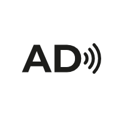 | Audiodeskrypcja | [Pobierz SVG](svg/audiodeskrypcja.svg) |
| 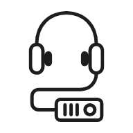 | Audioprzewodnik | [Pobierz SVG](svg/audioprzewodnik.svg) |
| 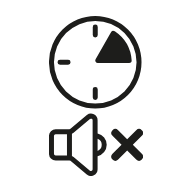 | Ciche godziny | [Pobierz SVG](svg/ciche-godziny.svg) |
| 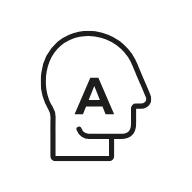 | Dostępność dla osób w spektrum autyzmu | [Pobierz SVG](svg/dostepnosc-dla-osob-w-spektrum-autyzmu.svg) |
| 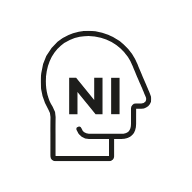 | Dostępność dla osób z niepełnosprawnością intelektualną | [Pobierz SVG](svg/dostepnosc-dla-osob-z-niepelnosprawnoscia-intelektualna.svg) |
| 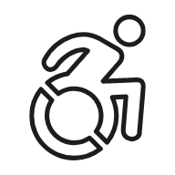 | Dostępność dla osób z niepełnosprawnością ruchową | [Pobierz SVG](svg/dostepnosc-dla-osob-z-niepelnosprawnoscia-ruchowa.svg) |
| 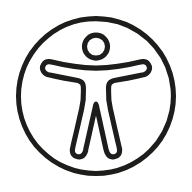 | Dostępność | [Pobierz SVG](svg/dostepnosc.svg) |
|  | ETR | [Pobierz SVG](svg/etr.svg) |
| 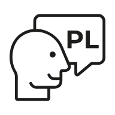 | Lektor polski | [Pobierz SVG](svg/lektor-polski.svg) |
| 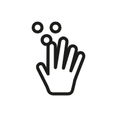 | Materiały dotykowe | [Pobierz SVG](svg/materialy-dotykowe.svg) |
| 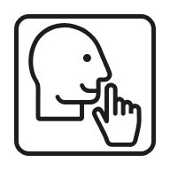 | Miejsce wyciszenia | [Pobierz SVG](svg/miejsce-wyciszenia.svg) |
| 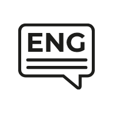 | Napisy angielskie | [Pobierz SVG](svg/napisy-angielskie.svg) |
|  | Napisy dla niesłyszących | [Pobierz SVG](svg/napisy-dla-nieslyszacych.svg) |
| 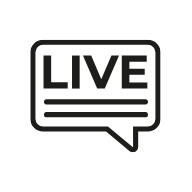 | Napisy na żywo | [Pobierz SVG](svg/napisy-na-zywo.svg) |
|  | Napisy polskie | [Pobierz SVG](svg/napisy-polskie.svg) |
| 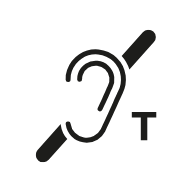 | Pętla indukcyjna | [Pobierz SVG](svg/petla-indukcyjna.svg) |
| 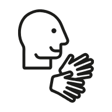 | Prowadzenie w PJM | [Pobierz SVG](svg/prowadzenie-w-pjm.svg) |
|  | Przedprzewodnik | [Pobierz SVG](svg/przedprzewodnik.svg) |
| 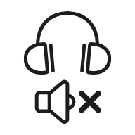 | Słuchawki wyciszające | [Pobierz SVG](svg/sluchawki-wyciszajace.svg) |
| 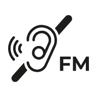 | System FM | [Pobierz SVG](svg/system-fm.svg) |
|  | Tłumaczenie na język obcy | [Pobierz SVG](svg/tlumaczenie-na-jezyk-obcy.svg) |
| 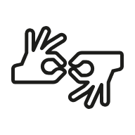 | Tłumaczenie na PJM | [Pobierz SVG](svg/tlumaczenie-na-pjm.svg) |

Pliki znajdują się w folderze [`svg/`](svg/). Podglądy w tabeli (PNG z białym tłem, folder [`previews/`](previews/)) służą wyłącznie do wyświetlania w README. Po kliknięciu „Pobierz SVG” otworzy się podgląd pliku, a przycisk „Download raw file” zapisze go na dysku. Cały zestaw pobierzesz jako ZIP z linku powyżej.

## Autorstwo i licencja

**Licencja:** [Creative Commons Uznanie autorstwa – Na tych samych warunkach 4.0 (CC BY-SA 4.0)](https://creativecommons.org/licenses/by-sa/4.0/deed.pl). Pełny tekst licencji: [LICENSE](LICENSE) oraz <https://creativecommons.org/licenses/by-sa/4.0/legalcode.pl>.

Piktogramy można udostępniać i adaptować, pod warunkiem podania autorstwa (jak wyżej), wskazania licencji i oznaczenia wprowadzonych zmian. Utwory zależne trzeba udostępniać na tej samej licencji. Przy publikacji na stronie internetowej należy podlinkować licencję lub wkleić pełny link do jej tekstu.

### Jak oznaczyć autorstwo

Przykładowy tekst do skopiowania:

> Piktogramy: Tomasz Grabowski, prawa autorskie: [Fundacja Kultury Bez Barier](https://kulturabezbarier.org/), licencja [CC BY-SA 4.0](https://creativecommons.org/licenses/by-sa/4.0/legalcode.pl).

Jeśli zmieniasz piktogramy, dopisz, co zostało zmienione, i udostępnij wynik na tej samej licencji.

### Logotyp Fundacji

Logotyp Fundacji Kultury Bez Barier, widoczny na początku tego README (`assets/fkbb-logo.png`), nie jest objęty licencją CC BY-SA 4.0. Wszelkie prawa do logotypu zastrzega Fundacja. Licencja dotyczy wyłącznie piktogramów i ich podglądów.

### Zmiany względem oryginału

W plikach SVG dodano deklarację XML z kodowaniem UTF-8, elementy `<title>` (nazwa), `<desc>` (opis graficzny) i `<metadata>` (autor, prawa autorskie, licencja, dane do oznaczania autorstwa) oraz atrybuty `xml:lang`, `role`, `aria-labelledby` i `aria-describedby`, a identyfikatory `id` i nazwy klas CSS zastąpiono unikalnymi. Nazwy plików zapisano małymi literami i bez polskich znaków, np. `dostepnosc.svg`; polskie nazwy piktogramów są w elemencie `<title>` i w tabeli powyżej. Kształty piktogramów nie zostały zmienione.

Podglądy PNG w folderze [`previews/`](previews/) powstały z plików SVG (biały margines i tło). Są utworami zależnymi i obowiązuje je ta sama licencja CC BY-SA 4.0.

## Zgłaszanie błędów

Błąd w piktogramie, literówkę w nazwie lub problem z plikiem SVG możesz zgłosić w zakładce [Issues](https://github.com/JacZad/piktogramy-dostepnosci/issues) tego repozytorium. Podaj nazwę piktogramu i opisz, co jest nie tak.
