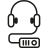

# Piktogramy dostępności

Zestaw 22 piktogramów w formacie SVG (48×48, jednokolorowe) oznaczających udogodnienia dostępnościowe: audiodeskrypcję, napisy, pętlę indukcyjną, tłumaczenie na PJM, miejsca wyciszenia i inne.

## Piktogramy

**[Pobierz cały zestaw (ZIP)](https://github.com/JacZad/piktogramy-dostepnosci/releases/latest/download/piktogramy-dostepnosci-svg.zip)** — pliki SVG i licencja. Wszystkie wydania: [Releases](https://github.com/JacZad/piktogramy-dostepnosci/releases).

| Podgląd | Nazwa | Plik |
|---|---|---|
|  | Audiodeskrypcja | [Pobierz SVG](svg/Audiodeskrypcja.svg) |
|  | Audioprzewodnik | [Pobierz SVG](svg/Audioprzewodnik.svg) |
|  | Ciche godziny | [Pobierz SVG](svg/Ciche%20godziny.svg) |
|  | Dostępność dla osób w spektrum autyzmu | [Pobierz SVG](svg/Dost%C4%99pno%C5%9B%C4%87%20dla%20os%C3%B3b%20w%20spektrum%20autyzmu.svg) |
|  | Dostępność dla osób z niepełnosprawnością intelektualną | [Pobierz SVG](svg/Dost%C4%99pno%C5%9B%C4%87%20dla%20os%C3%B3b%20z%20niepe%C5%82nosprawno%C5%9Bci%C4%85%20intelektualn%C4%85.svg) |
|  | Dostępność dla osób z niepełnosprawnością ruchową | [Pobierz SVG](svg/Dost%C4%99pno%C5%9B%C4%87%20dla%20os%C3%B3b%20z%20niepe%C5%82nosprawno%C5%9Bci%C4%85%20ruchow%C4%85.svg) |
|  | Dostępność | [Pobierz SVG](svg/Dost%C4%99pno%C5%9B%C4%87.svg) |
|  | ETR | [Pobierz SVG](svg/ETR.svg) |
|  | Lektor polski | [Pobierz SVG](svg/Lektor%20polski.svg) |
|  | Materiały dotykowe | [Pobierz SVG](svg/Materia%C5%82y%20dotykowe.svg) |
|  | Miejsce wyciszenia | [Pobierz SVG](svg/Miejsce%20wyciszenia.svg) |
|  | Napisy angielskie | [Pobierz SVG](svg/Napisy%20angielskie.svg) |
|  | Napisy dla niesłyszących | [Pobierz SVG](svg/Napisy%20dla%20nies%C5%82ysz%C4%85cych.svg) |
|  | Napisy na żywo | [Pobierz SVG](svg/Napisy%20na%20%C5%BCywo.svg) |
|  | Napisy polskie | [Pobierz SVG](svg/Napisy%20polskie.svg) |
|  | Pętla indukcyjna | [Pobierz SVG](svg/P%C4%99tla%20indukcyjna.svg) |
|  | Prowadzenie w PJM | [Pobierz SVG](svg/Prowadzenie%20w%20PJM.svg) |
|  | Przedprzewodnik | [Pobierz SVG](svg/Przedprzewodnik.svg) |
|  | Słuchawki wyciszające | [Pobierz SVG](svg/S%C5%82uchawki%20wyciszaj%C4%85ce.svg) |
|  | System FM | [Pobierz SVG](svg/System%20FM.svg) |
|  | Tłumaczenie na język obcy | [Pobierz SVG](svg/T%C5%82umaczenie%20na%20j%C4%99zyk%20obcy.svg) |
|  | Tłumaczenie na PJM | [Pobierz SVG](svg/T%C5%82umaczenie%20na%20PJM.svg) |

Pliki znajdują się w folderze [`svg/`](svg/). Po kliknięciu „Pobierz SVG” otworzy się podgląd pliku, a przycisk „Download raw file” zapisze go na dysku. Cały zestaw pobierzesz jako ZIP z linku powyżej.

## Autorstwo i licencja

**Autor piktogramów:** Tomasz Grabowski
**Prawa autorskie:** Fundacja Kultury Bez Barier
**Licencja:** [Creative Commons Uznanie autorstwa – Na tych samych warunkach 4.0 (CC BY-SA 4.0)](https://creativecommons.org/licenses/by-sa/4.0/deed.pl). Pełny tekst licencji: [LICENSE](LICENSE) oraz <https://creativecommons.org/licenses/by-sa/4.0/legalcode.pl>.

Piktogramy można udostępniać i adaptować, pod warunkiem podania autorstwa (jak wyżej), wskazania licencji i oznaczenia wprowadzonych zmian. Utwory zależne trzeba udostępniać na tej samej licencji. Przy publikacji na stronie internetowej należy podlinkować licencję lub wkleić pełny link do jej tekstu.

### Zmiany względem oryginału

W plikach SVG dodano elementy `<title>` i `<metadata>` (autor, prawa autorskie, licencja) oraz atrybuty `role` i `aria-labelledby`, a identyfikatory `id` i nazwy klas CSS zastąpiono unikalnymi. Poprawiono też nazwy plików. Kształty piktogramów nie zostały zmienione.